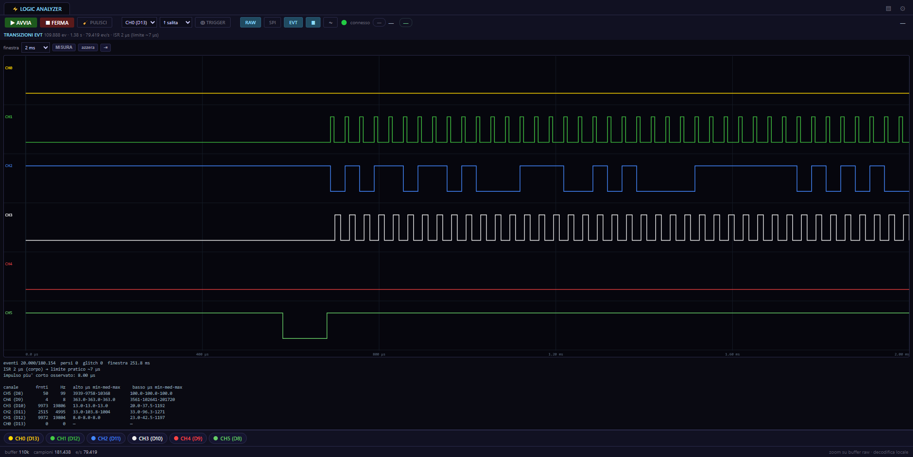

# Logic Analyzer — 6 channels

A programmable 6-channel logic analyzer built on an Arduino Uno/Nano, with a
Python backend and a browser front-end.

Six digital lines, up to **2 Mbaud** on the wire, a timing base on a hardware
timer, a **transition-based capture mode with 0.5 µs resolution**, and honest
counters for every sample it loses.



*Transition (EVT) view, running on the synthetic demo backend — no hardware
needed. The statistics table at the bottom is computed from the event stream
itself, at 0.5 µs resolution: 13.0 µs pulses on CH3 and a 363.0 µs strobe on
CH4 are read from the same capture.*

---

## Why this exists

I had an electronic device I wanted to understand, and no documentation for it.
The instruments that could have helped were either out of budget or too slow to
see what I needed to see.

So I built one. It started as a way to answer a single question, and it turned
into a project in its own right: measuring its own limits, finding them, and
fixing them. The [engineering notes](docs/engineering-notes.md) document that
process — including a case where the instrument was measuring itself instead of
the signal, and the deliberate perturbation used to prove it.

---

## What it does

- **6 digital channels** sampled with a hardware timer base (Timer1, CTC)
- **Three capture modes**:
  - `RAW` — 1 byte per sample, no framing, maximum throughput
  - `OSC` — same, with a periodic sync header for stream recovery
  - `EVT` — **transition-only encoding** with 0.5 µs timestamps: idle costs
    zero bytes, and signals faster than the sampling period stay visible
- **Automatic period search** (`T0`): probes the maximum rate the serial link
  sustains without dropping samples, then locks it
- **Loss accounting**: dropped samples, dropped events and unobservable
  glitches are counted and reported *in-band*, so the timeline is never
  silently wrong
- **Live web view**: continuous stream over SSE, zoom, trigger, per-channel
  visibility and renaming, SPI decoding

### Measured performance

| | v1 | v2 |
|---|---|---|
| Timing base error | +45% (15 µs requested → 21.8 µs actual) | **0.1%** (T50: 19977 vs 20000 samples/s) |
| Minimum observable pulse | 26 µs | **~7 µs** |
| EVT timestamp resolution | — | **0.5 µs** |
| Interrupt service time | 29 µs | **2 µs** |

---

## Architecture

Three layers, each with one job:

```
┌──────────────────────────────────────────────────────────────┐
│ LAYER 1 — FIRMWARE (Arduino)                                 │
│ A dumb sensor. Timer1 + ISR capture into a ring buffer,      │
│ drained to the UART. No interpretation, no formatting,       │
│ no intelligence. It only counts what it loses.               │
└──────────────────────────────────────────────────────────────┘
                            │ USB serial, up to 2 Mbaud
┌──────────────────────────────────────────────────────────────┐
│ LAYER 2 — BACKEND (Python / Flask)                           │
│ Transparent. Keeps a 2M-sample circular buffer with an        │
│ absolute index, pushes new samples to each SSE client with    │
│ its own cursor, auto-reconnects when the board disappears.    │
└──────────────────────────────────────────────────────────────┘
                            │ HTTP + Server-Sent Events
┌──────────────────────────────────────────────────────────────┐
│ LAYER 3 — WEB UI (vanilla JS, no framework)                  │
│ All of the analysis: local buffer, zoom, trigger, edge        │
│ search by binary search, SPI decoding, EVT timeline view.     │
└──────────────────────────────────────────────────────────────┘
```

The split matters: the board never spends CPU on formatting, and the browser
never waits on the board to interpret data.

---

## Hardware

An Arduino Uno or Nano (ATmega328P). Nothing else.

| Arduino | Channel | PORTB bit |
|---|---|---|
| D13 | CH0 | 5 |
| D12 | CH1 | 4 |
| D11 | CH2 | 3 |
| D10 | CH3 | 2 |
| D9 | CH4 | 1 |
| D8 | CH5 | 0 |

- All channels default to **hi-Z (plain INPUT)** — the instrument does not
  influence the circuit under test. `U` enables pull-ups, `Z` disables them.
- Connect **GND** to the ground reference of the device under test.
- All six channels share `PCINT0` on PORTB. See
  [Limitations](#limitations).

---

## Serial protocol

All commands are newline-terminated. Initial baud rate: **2,000,000**.

| Command | Meaning | Response |
|---|---|---|
| `B<baud>` | Change baud rate at runtime (via UBRR) | `BR<baud>` |
| `T<us>` | Sampling period in µs. `T0` = automatic search | `TR<us>` |
| `M<6bit>` | Channel mask: binary (`M101010`), hex (`M0x3F`) or decimal (`M63`) | `MR<6bit>` |
| `R<bit>` | Resolution (R1 digital; only R1 is supported by the timer engine) | `RR<bit>` |
| `RAW` | Start raw stream, 1 byte per sample | `RAW_GO` … `RAW_END` |
| `OSC` | Start stream with a header every 256 samples | `OSC_START` … `OSC_END` |
| `EVT` | Start transition stream | `EVT_GO` … `EVT_END` |
| `X` | Stop the stream | `X_OK` |
| `Q` | Counters | `Q:<period>,<samples>,<lost>,<events>,<events_lost>,<glitches>,<mode>` |
| `Z` / `U` | All channels hi-Z / pull-ups | `Z_OK` / `U_OK` |
| `PING` / `STATUS` | Connectivity / configuration | `PONG` / `S:…` |

Sample bytes are masked to 6 bits, so `0xFF` never appears as data — which is
what makes in-band loss markers unambiguous.

### EVT encoding

```
[0x80|d0][0x80|d1]…   delta pieces, 7 bits each, little-endian
[0x00–0x3F]           channel state (bit0 = CH5 … bit5 = CH0)
[0x40–0x7F]           gap: (value & 0x3F) events lost to a full ring
[0xFF][hi][lo]        dropped samples marker
[0x7F][hi][lo]        glitch counter report (once per second)
```

Delta is in 0.5 µs ticks. A delta of zero means two edges in the same tick.

---

## Quick start

**1. Flash the firmware**

Open `firmware/logic-analyzer/` in the Arduino IDE and upload it to an
Uno/Nano. Or with `arduino-cli`:

```bash
arduino-cli compile --fqbn arduino:avr:uno firmware/logic-analyzer
arduino-cli upload -p COM3 --fqbn arduino:avr:uno firmware/logic-analyzer
```

Uses 36% of flash and 60% of SRAM on an ATmega328P.

**2. Start the backend**

```bash
cd backend
pip install -r requirements.txt
python server.py
```

The serial port defaults to `COM11`; override it:

```bash
LA_PORT=COM4 python server.py        # Linux/macOS
set LA_PORT=COM4 && python server.py # Windows
```

**3. Open the web UI**

<http://127.0.0.1:8788> → press **▶ AVVIA**.

> **No hardware at hand?** Run `python demo_server.py` instead of
> `server.py`. It generates a synthetic signal with the same *shapes* the
> instrument was built to observe, and serves it through the identical API —
> useful to try the interface, tweak the front-end, or take screenshots.

> Keep a **single tab** open. Browsers allow 6 connections per host; with
> several tabs open every new request queues for up to ~15 s and the page
> looks slow. `/api/status` exposes `sse_clients` so you can spot forgotten
> tabs.

---

## Repository layout

```
firmware/logic-analyzer/       Arduino sketch (C++ / AVR)
backend/server.py              Flask backend: serial → ring buffer → SSE
backend/demo_server.py         Synthetic signal generator (no hardware)
backend/static/index.html      Web UI (vanilla JS, canvas)
docs/engineering-notes.md      How the instrument was measured and improved
docs/screenshot-evt.png        Transition view screenshot
```

---

## Limitations

- **The six channels share one interrupt.** A fast channel degrades the
  timestamp accuracy of the slow channels. The short ISR reduces the effect
  but cannot remove it. The `EVT_ISR_PAD` build option exists to check whether
  a given measurement is the signal or the instrument.
- Only 512 bytes of ring buffer in SRAM, and 128 capture slots: at high edge
  rates events are lost. They are counted and declared, never hidden.
- `R8` (averaged resolution) exists in the protocol but is not supported by
  the timer-based engine.
- The backend targets a single local board on one serial port.

---

## License

MIT — see [LICENSE](LICENSE).
